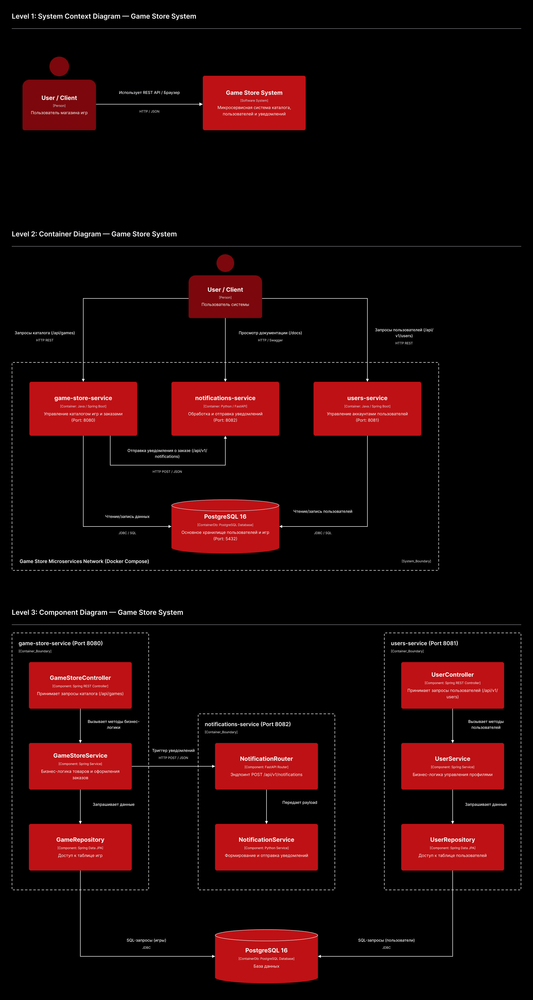

# Game Store & Game Library API

Архитектурная документация (C4 Model) — Микросервисная архитектура

## 1. Описание системы и пользовательский сценарий

**Game Store & Game Library API** — микросервисный веб-сервис для каталогизации, покупки игр и управления профилями пользователей.

### Основной пользовательский сценарий:
1. **Каталог и заказы:** Пользователь отправляет REST-запрос на просмотр каталога или оформление заказа через `game-store-service` (порт 8080).
2. **Управление профилями:** Запросы к профилям пользователей обрабатываются отдельным микросервисом `users-service` (порт 8081).
3. **Уведомления:** При создании заказа `game-store-service` отправляет внутренний HTTP POST-запрос в `notifications-service` (Python/FastAPI, порт 8082) для формирования уведомления.
4. **Хранение данных:** Все сервисы сохраняют и запрашивают данные из основной базы данных **PostgreSQL 16** (порт 5432).

---

## 2. Описание компонентов по уровням C4

### C4 Level 1 — Context (Контекст)
* **User / Client:** Пользователь системы (клиентское приложение / Swagger UI).
* **Game Store System:** Микросервисный комплекс (каталог, пользователи, уведомления).

### C4 Level 2 — Container (Контейнеры)
* **game-store-service (Java / Spring Boot, port 8080):** Микросервис управления витриной игр и заказами.
* **users-service (Java / Spring Boot, port 8081):** Микросервис управления аккаунтами пользователей.
* **notifications-service (Python / FastAPI, port 8082):** Микросервис обработки и отправки уведомлений.
* **PostgreSQL 16 (port 5432):** Единая реляционная база данных.

### C4 Level 3 — Component (Компоненты микросервисов)
* **GameStoreController / UserService / NotificationRouter:** Слой REST-контроллеров и роутеров.
* **GameStoreService / UserService / NotificationService:** Слой бизнес-логики.
* **GameRepository / UserRepository (Spring Data JPA):** Слой доступа к реляционной БД.

---

## 3. Архитектурная диаграмма

